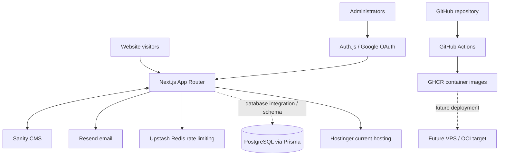

# Golden Palmera Global — System Architecture

**Status:** Engineering reference  
**Repository:** `goldenpalmera/golden_palmera_global`  
**Primary domain:** `https://goldenpalmeraglobal.com`

## 1. Purpose and scope

This document describes the website's application architecture, major integrations, delivery pipeline, operational boundaries, and known implementation caveats. It is intended to help developers maintain the system without assuming that planned infrastructure is already in production.

Golden Palmera Global (GPG) is an African agricultural commodities and international trade company. The website presents the company, its commodity portfolio, services, compliance and partnership information, publishes insights, and captures enquiries from international buyers and partners.

## 2. Technology stack

The repository's package manifest and workflows are the source of truth for installed tooling. The current declared stack includes:

| Area | Technology |
|---|---|
| Application framework | Next.js 16.x App Router |
| UI runtime | React 19.2.8 |
| Language | TypeScript |
| Styling | Tailwind CSS v4 |
| UI primitives | Radix UI |
| Icons | Lucide React and Font Awesome |
| CMS and content | Sanity, `next-sanity`, GROQ |
| Database toolkit | Prisma 7 with PostgreSQL provider and `pg` adapter |
| Authentication | Auth.js / NextAuth v5 beta |
| Validation | Zod 4 |
| Email | Resend |
| Rate limiting | Upstash Redis and Upstash Ratelimit |
| Unit tests | Vitest |
| Browser tests | Playwright |
| Containerization | Docker, multi-stage Dockerfile |
| CI/CD | GitHub Actions |
| Container registry | GitHub Container Registry (GHCR) |
| Image security and provenance | Trivy, Cosign, BuildKit provenance/SBOM |

Use the lockfile to determine exact resolved versions. Do not infer installed versions from semver ranges in `package.json`.

## 3. High-level system context

The website is a Next.js application deployed to Hostinger today. Sanity provides managed content and is integrated server-side through a server-only client. Resend handles transactional enquiry notifications. Upstash provides rate-limiting infrastructure. Google OAuth/Auth.js protects administrative access.

The repository also contains a Docker/OCI-style deployment path. This VPS pipeline is retained for a future hosting migration; it must not be described as the current production hosting path.



The diagram distinguishes the current Hostinger deployment from the future container/VPS route. The PostgreSQL model and Prisma configuration do not, by themselves, prove that all live enquiry records are persisted to PostgreSQL. Verify the active service implementation before relying on that assumption.

## 4. Application structure and rendering

The application uses the Next.js App Router. Server components and server-side data access should be preferred for content and integration work. Client components should be limited to interactions that require browser state or event handling.

Expected areas include:

- `app/`: route segments, layouts, pages, route handlers, loading/error boundaries and admin routes.
- `components/`: shared presentation and interaction components.
- `sanity/`: Sanity configuration, schemas, queries, image helpers and server-side clients.
- `prisma/`: Prisma schema and database configuration.
- `app/generated/prisma/`: generated Prisma client output; generated files should not be hand-edited.
- `docker/` and `Dockerfile`: future container deployment assets.
- `.github/workflows/`: CI, image build, deployment and notification workflows.

Confirm exact directory names in the current branch before changing code; this overview is conceptual rather than a guarantee that every listed folder exists on every branch.

## 5. Content management — Sanity

Sanity is the CMS for editorial and structured website content, including commodities, services, page content and insights. The Studio is mounted in the Next.js application under `/studio`.

The server-side Sanity client is marked server-only, reads `SANITY_API_TOKEN`, and is configured with `useCdn: false`. Keep privileged tokens out of client bundles. Public project and dataset identifiers may be exposed only where required by Sanity's client configuration.

Content changes should follow the schema/query/type workflow:

1. Update or add the schema in the appropriate Sanity schema directory.
2. Update GROQ queries and TypeScript types together.
3. Test the affected page and Studio.
4. Check preview/visual-editing integrations if applicable.
5. Deploy through the normal branch and CI process.

Do not delete or recreate a Sanity dataset as a troubleshooting shortcut. Export or back up content before destructive operations.

## 6. Data layer — Prisma and PostgreSQL

The repository contains a PostgreSQL Prisma datasource and models for enquiries and rate-limit events. The build and type-check scripts generate the Prisma client.

Important distinction: a Prisma schema is evidence of a defined data model, not proof that the production enquiry flow currently writes to PostgreSQL. Some enquiry/content services have used Sanity-backed persistence. Before changing persistence, trace the active route handler through its service/repository implementation and confirm the production environment variables and records.

Database changes must be handled through reviewed Prisma migrations. Never run destructive reset commands against production. Do not assume that a configured `DATABASE_URL` means the database is the system of record.

## 7. Authentication and authorization

Auth.js / NextAuth v5 beta is used for administrator authentication, with Google OAuth credentials and an administrator email allowlist. Authentication proves identity; authorization must still be enforced on every protected server route and action.

- Keep OAuth secrets and `AUTH_SECRET` server-side.
- Enforce the administrator allowlist on the server.
- Protect admin pages and API routes independently.
- Use secure cookie/session settings appropriate to HTTPS production.
- Do not rely on hiding navigation links as an authorization control.

Verify callback URLs and provider configuration separately for local, staging and production environments.

## 8. Enquiry and email flow

Enquiry forms validate input with Zod and use server-side controls such as origin validation, honeypot fields, request identifiers and rate limiting. Enquiry types and statuses include product/general, partnership and export-buyer categories, with statuses such as `NEW`, `IN_PROGRESS`, `CONTACTED`, `RESOLVED` and `REJECTED` where supported by the active model/service.

Resend sends enquiry notifications. Persistence and notification delivery are separate operations: a failed email does not necessarily mean the enquiry was not saved. Support staff should check the enquiry record before asking a visitor to submit again.

## 9. Security controls

The repository configures security headers in Next.js, including content-type sniffing protection, referrer policy, frame restrictions, permissions policy and HSTS. HSTS with `includeSubDomains` assumes all covered subdomains are HTTPS-ready.

A nonce-based Content Security Policy has been under development. CSP changes must be tested against Next.js runtime chunks, Turbopack, Auth.js and Sanity Studio/bridge functionality. Do not disable CSP globally to work around a blocked asset.

Other controls include schema validation, secret separation, rate limiting, dependency scanning, container scanning, non-root runtime configuration, image signing and provenance verification. These controls should be described as implemented only when verified in the target branch and environment.

## 10. Build and test commands

The package manifest currently defines:

```bash
npm ci
npm run dev
npm run lint
npm run type-check
npm test
npm run test:e2e
npm run build
npm run start
```

The `test` script runs `vitest run`. Review the CI workflow's test-step condition: the current workflow checks for Jest configuration files before running the test command. If the repository uses Vitest without Jest config, the CI unit-test step may be skipped even though the local test script is configured. Correct and verify this condition before treating CI as proof that Vitest ran.

The build script runs Prisma generation before `next build`. Build flags can differ by branch; consult the branch's package manifest.

## 11. CI and branch governance

The repository's stated development process is:

- GitHub Actions run on every push to feature branches.
- GitHub Actions also run on pull requests before merge.
- The protected `main` branch does not accept direct pushes.
- Changes targeting `main` require administrator approval.
- The normal promotion path is feature branch → `develop` → `staging` → `main` / production, subject to repository rules and approved releases.

The CI workflow also declares push and pull-request triggers for `develop`, `staging` and `main`. Check the actual workflow YAML and branch-protection settings when changing this process.

## 12. Hosting and deployment architecture

**Current production hosting:** Hostinger. The domain, business hosting and business email are managed through Hostinger.

**Future deployment target:** a VPS/OCI environment using Docker and GHCR. This pipeline is retained but is not the current live hosting path. The existence of a deployment workflow or Docker image does not mean the VPS is provisioned or serving production traffic.

The repository contains environment deployment workflows with the names `deploy_development`, `deploy_staging` and `deploy_production` as referred to by the team. Their checked-in workflow filenames currently use hyphenated forms such as `deploy-development.yml`, `deploy-staging.yml` and `deploy-production.yml`. Confirm exact files in the branch being changed.

The future pipeline builds an image, scans it, creates provenance/SBOM metadata, signs it with Cosign, publishes it to GHCR, verifies signature/provenance during deployment, transfers Docker deployment assets to the target host, deploys and checks health. The development workflow is gated by `ENABLE_VPS_DEPLOYMENT`. Staging and production workflows have their own trigger/approval model.

Known verification items:

- The deployment scripts expect a health endpoint returning JSON with `status: "ok"`; the expected `/api/health` route was not found in the inspected branch at the time of documentation review.
- The development workflow's manual-dispatch path must be checked because its job condition references `workflow_run` event fields.
- Verify the current workflow filenames, branch triggers, GitHub Environments, secrets and protection rules before enabling VPS deployment.
- Confirm OCI compute, firewall, DNS, TLS, SSH access, Docker runtime, backups, monitoring and rollback before migration.
- Hostinger shared Business Web Hosting must not be treated as a Docker VPS unless the purchased service explicitly supports that runtime.

## 13. Environment configuration

Environment variable names are defined by source usage and workflow configuration. Common variables include:

- Site: `NEXT_PUBLIC_SITE_URL`
- Sanity: `NEXT_PUBLIC_SANITY_PROJECT_ID`, `NEXT_PUBLIC_SANITY_DATASET`, `SANITY_API_TOKEN`, `SANITY_API_VERSION`
- Database: `DATABASE_URL`
- Authentication: `AUTH_SECRET`, `AUTH_URL` where used, `AUTH_GOOGLE_ID`, `AUTH_GOOGLE_SECRET`, `ADMIN_EMAIL`
- Email: `RESEND_API_KEY`, `RESEND_FROM_EMAIL`, `INQUIRY_NOTIFICATION_EMAIL`
- Rate limiting: `UPSTASH_REDIS_REST_URL`, `UPSTASH_REDIS_REST_TOKEN)

Not every variable is required in every environment. Confirm exact names and fallback behavior in source before creating or rotating secrets. Never commit populated environment files.

## 14. Architecture decision principles

1. Keep CMS content and application logic separated.
2. Keep privileged integrations server-only.
3. Validate all untrusted input at the server boundary.
4. Treat database persistence as an explicit implementation decision, not an assumption inferred from Prisma models.
5. Keep the current Hostinger deployment and future VPS pipeline clearly distinguished.
6. Promote the same immutable image between environments where the container pipeline is used.
7. Require health verification and a tested rollback path before production migration.
8. Document verified behavior separately from planned or partially implemented controls.

## 15. Open verification items

- Confirm actual production enquiry persistence path.
- Confirm Vitest executes in CI rather than being skipped by the Jest-config condition.
- Implement or verify the health endpoint expected by deployment scripts.
- Validate manual dispatch behavior in the development deployment workflow.
- Verify the current CSP nonce behavior with Next.js and Sanity.
- Confirm Hostinger deployment method and production backup/restore procedures.
- Provision and test VPS/OCI infrastructure before enabling VPS deployment.
- Reconcile workflow filenames and names with the team's naming convention.

---
**Maintenance:** Update this document whenever the stack, persistence path, authentication model, hosting provider, or deployment workflow changes.
